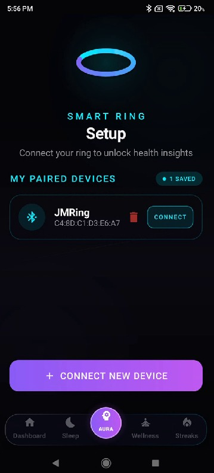
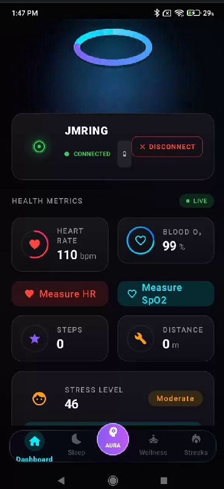
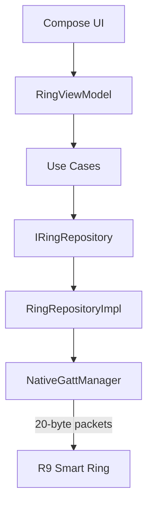
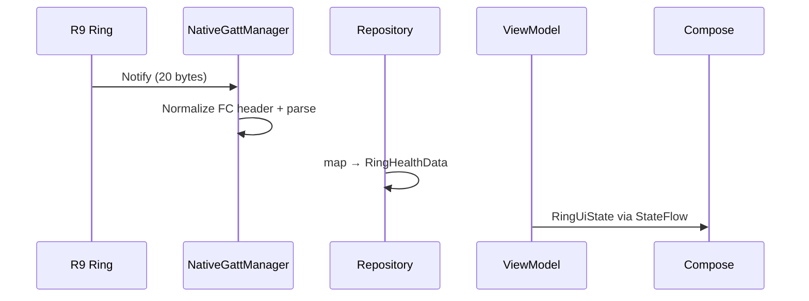

# FitnessAndroidApp — R9 Smart Ring Health Monitor

**DKGS Labs** · Android BLE Health Platform

Real-time health monitoring for the R9 Smart Ring — Kotlin, Jetpack Compose, Clean Architecture + MVVM, and a **pure native BLE GATT** stack.  
**No proprietary SDK at runtime.** Protocol fully reverse-engineered from the Manridy MRD SDK.

[](https://developer.android.com)
[](https://kotlinlang.org)
[](https://developer.android.com/jetpack/compose)
[](https://developer.android.com/topic/architecture)
[](#technical-deep-dive)

---

## App Preview

| Setup — pair & connect | Dashboard — live vitals |
|:---:|:---:|
|  |  |
| Saved devices, MAC address, connect / scan new ring | Connected ring, HR, SpO₂, steps, stress, measure actions |

---

## One-liner (interview / share)

> Built an Android companion for a smart ring that talks BLE **without** the vendor SDK — reverse-engineered the 20-byte GATT protocol, mapped every metric at the byte level, and shipped a Clean Architecture Compose app with live vitals, timed measurements, and auto-reconnect.

---

## What this project demonstrates

| Skill | Evidence in this repo |
|-------|------------------------|
| **BLE / IoT** | Native `BluetoothGatt`, service discovery, notify/write, keep-alive polling |
| **Reverse engineering** | Decompiled MRD `.aar`, live packet capture, byte-offset parsers |
| **Architecture** | Clean layers: Presentation → Domain → Data → BLE |
| **Modern Android** | Jetpack Compose, Material 3, StateFlow, Coroutines |
| **Product thinking** | Setup UX, live dashboard, timed measure flows, reconnect strategy |
| **Ownership** | No black-box SDK — full control of protocol, parsing, and roadmap |

---

## Features

| Metric | UI | Measurement |
|--------|----|-------------|
| Heart Rate | Live BPM + Measure HR | 30s timed |
| SpO₂ | Live % + Measure SpO₂ | 30s timed |
| Blood Pressure | Systolic / diastolic | 30s timed |
| Stress / HRV | Score + Moderate / etc. | 30s timed |
| Steps / Distance | Activity cards | Automatic / keep-alive |
| Sleep | Deep / light / awake + quality | Historical |
| Battery / Firmware | Status on connect | Real-time / on-connect |
| Temperature | On-demand | On-demand |

**Connection UX:** scan → save device → connect / disconnect · auto-reconnect with exponential backoff (2s → 4s → 8s, max 3).

---

## Architecture

Unidirectional flow: **Ring → GATT → Repository → ViewModel → Compose UI**.



| Layer | Role | Key files |
|-------|------|-----------|
| Presentation | Screens, state, user actions | `DashboardScreen`, `RingSetupScreen`, `RingViewModel` |
| Domain | Contracts & models | `IRingRepository`, `RingHealthData`, use cases |
| Data | BLE → domain mapping | `RingRepositoryImpl` |
| BLE | GATT + parsers | `NativeGattManager` (~1k LOC), `BleState` |



---

## Tech stack

| Area | Choice |
|------|--------|
| Language | Kotlin |
| UI | Jetpack Compose, Material 3, dark neon / glass UI |
| Architecture | Clean Architecture + MVVM |
| Async | Coroutines, StateFlow |
| BLE | Native Android GATT (no runtime SDK) |
| DI | Manual `AppContainer` (Hilt on roadmap) |
| Min SDK | 24 · JDK 17 |

---

## Why native BLE (not the vendor SDK)

The ring ships with an obfuscated Manridy MRD `.aar`. That is a black box: brittle upgrades, hard to debug health accuracy, limited ownership.

**What we did instead**

1. **Static analysis** — JADX decompile → command builder, response parser, UUIDs  
2. **Live capture** — Logcat + nRF Connect against real ring traffic  
3. **Byte mapping** — validated offsets; normalized packets that omit the `0xFC` header  

**Result:** `NativeGattManager` sends/receives raw 20-byte packets with full transparency.

---

## Technical deep dive

<details>
<summary><b>BLE UUIDs & command table</b></summary>

| UUID | Role |
|------|------|
| `f000efe0-0451-4000-0000-00000000b000` | Primary service |
| `f000efe1-0451-4000-0000-00000000b000` | Write (app → ring) |
| `f000efe3-0451-4000-0000-00000000b000` | Notify (ring → app) |

Commands are **20 bytes**: `FC` + MetricID + SubCmd + padding.

| Command | Hex | Notes |
|---------|-----|-------|
| Battery | `FC 0F 06 …` | Level + charging |
| Firmware | `FC 0F 05 …` | Version |
| Heart Rate | `FC 0A 00 …` | Last reading |
| Steps | `FC 03 00 …` | Steps / distance / calories |
| SpO₂ | `FC 12 00 …` | Oxygen % |
| Blood Pressure | `FC 11 00 …` | Sys / dia |
| HRV / Stress | `FC 5D 00 …` | Stress |
| Start timed tests | `FC 09 01/02/04/09 …` | HR / BP / SpO₂ / Stress |

Responses may arrive **with or without** `0xFC`; the app prepends the header when missing so parsers stay consistent.

</details>

<details>
<summary><b>Keep-alive & timed measurements</b></summary>

- **On connect:** staggered requests (battery → firmware → vitals) to avoid BLE congestion  
- **Keep-alive:** one metric every ~10s (full cycle ~70s)  
- **Timed tests:** request every 2s for 30s + progress UI  

</details>

<details>
<summary><b>Known limitations</b></summary>

| Item | Status |
|------|--------|
| Temperature | Parsed; UI model wiring incomplete |
| Sleep history | Multi-packet assembly incomplete |
| HRV → stress | Raw HRV used as stress score |
| Sport / stress history | Not fully implemented |
| Scan filter | No service UUID filter yet |

</details>

---

## Project structure

```
src/main/kotlin/com/fitness/app/
├── presentation/ring/     Setup + dashboard UI, ViewModel
├── domain/                Models, repository contract, use cases
├── data/repository/       RingRepositoryImpl
├── ble/                   NativeGattManager ★, BleState
├── ui/                    Shared components, theme, timers
└── core/di/               AppContainer
```

Extra docs: `R9_RING_BLE_INTEGRATION_GUIDE.md`, `MRD_SDK_PROTOCOL_REFERENCE.md`, `documentation/`.

---

## Run it

**Need:** Android Studio (Hedgehog+), JDK 17, physical device with BLE, R9 ring.

```bash
git clone https://github.com/soumya07ad/ble-ring-app.git
# Open in Android Studio → Sync → Run on device
./gradlew compileDebugKotlin
```

| Permission | Purpose |
|------------|---------|
| `BLUETOOTH_SCAN` / `BLUETOOTH_CONNECT` | Discover & connect (API 31+) |
| `ACCESS_FINE_LOCATION` | Required for BLE scan |
| Legacy `BLUETOOTH*` | API &lt; 31 |

**Quick demo:** Setup → Connect New Device / saved JMRing → Dashboard shows LIVE metrics → Measure HR / SpO₂.

---

## Roadmap

| Priority | Item |
|----------|------|
| High | Room history + charts |
| Medium | Temperature in UI, sleep packet assembly, alerts |
| Architecture | Hilt, unit tests, module split, WorkManager sync |

---

## Talking points (interview)

1. **Problem:** vendor SDK was obfuscated and opaque for a health product.  
2. **Approach:** reverse-engineer protocol → native GATT → Clean Architecture app.  
3. **Hard parts:** headerless responses shifting byte offsets; BLE congestion → staggered + keep-alive design.  
4. **Result:** live dashboard (HR, SpO₂, stress, steps), timed measures, reconnect — without shipping the `.aar`.  
5. **Next:** persistence, trends, stronger tests, DI.

---

## License

Copyright © 2026 **DKGS Labs**. All rights reserved.

---

<p align="center">
  <b>DKGS Labs</b> · R9 Smart Ring · Pure Native BLE · Share-ready portfolio project
</p>
